<p align="center">
  <a href="https://dexterity-admin.github.io/Sleuth/">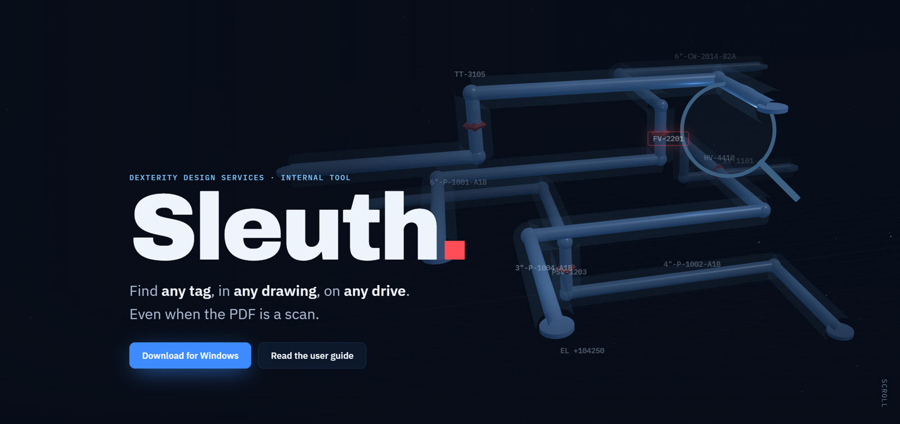</a>
</p>

<p align="center">
  <a href="https://github.com/dexterity-admin/Sleuth/releases/latest"></a>
  <a href="https://github.com/dexterity-admin/Sleuth/actions/workflows/build.yml"></a>
  
  
  <a href="docs/Sleuth-User-Guide.pdf"></a>
</p>

<h3 align="center">
  <a href="https://github.com/dexterity-admin/Sleuth/releases/latest">Download</a> ·
  <a href="https://dexterity-admin.github.io/Sleuth/">Website</a> ·
  <a href="docs/Sleuth-User-Guide.pdf">User guide (view)</a> ·
  <a href="https://github.com/dexterity-admin/Sleuth/raw/main/docs/Sleuth-User-Guide.pdf">User guide (download)</a> ·
  <a href="CHANGELOG.md">What's new</a>
</h3>

**Sleuth** is the internal drawing search tool of Dexterity Design Services. Type a tag, line number, document number or any text printed on a drawing. Sleuth shows every file that contains it, says **why** each one matched, and opens the page with the text **circled in red**, even when the PDF is a scan.

<p align="center">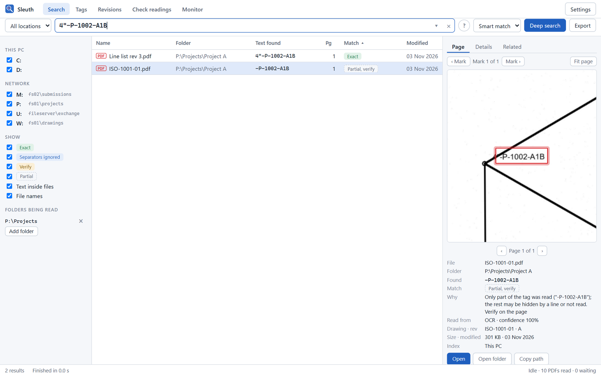</p>
<p align="center"><sub>On the scanned isometric a pipe line crosses the <code>4"</code>, so only <code>-P-1002-A1B</code> could be read. Sleuth 1.0 still finds it, marks it on the page, and labels it <b>Partial, verify</b> with the reason. It is never shown as exact.</sub></p>

## New in 1.1: one office index, every file type

> **Development build.** 1.1 is on the Development update channel for testing; the stable release follows. The [latest release](https://github.com/dexterity-admin/Sleuth/releases/latest) is still 1.0.2.

| | |
|---|---|
| **One office index** | Kept in the shared folder (`U:\Sleuth-cache`), not on each PC: a PC keeps only settings and a few MB of work in progress. One PC lists each share for everybody; every PC that is on reads for everybody, and a document is read once for the whole office. |
| **Every file type** | Excel, Word, PowerPoint, Outlook emails, text and CSV, AutoCAD DWG/DXF, MicroStation DGN (V7, V8 and PDS `.i01` natives) and scanned images, as well as PDF. |
| **One row per document** | The PDF, DWG and DGN of one drawing are one result, each a click away, with the reason they belong together. |
| **Faster reading that never gets in the way** | Documents needing no OCR are read many at a time; scans are read by separate processes at the lowest priority, ramping up while the PC is free. |
| **Pause, resume, now** | Each stage can be paused, resumed or started at once by hand, and reading can run at full speed for an hour. |

See [what is new in 1.1](CHANGELOG.md) for the details and the measured speeds.

## New in 1.0.1: indexing you can watch

1.0.0 could leave a new install with nothing to search: reading folders chosen by drive letter (`Z:\`) were never read, and the walk of each drive skipped most subfolders. 1.0.1 fixes both and shows what Sleuth is doing at every moment. An existing index is repaired when you install it.

<p align="center">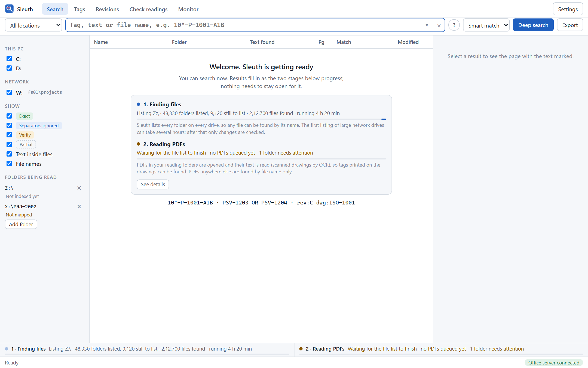</p>
<p align="center"><sub>A new install says what happens next and how far it has got. The status strip at the bottom stays visible everywhere.</sub></p>

<table>
  <tr>
    <td width="50%">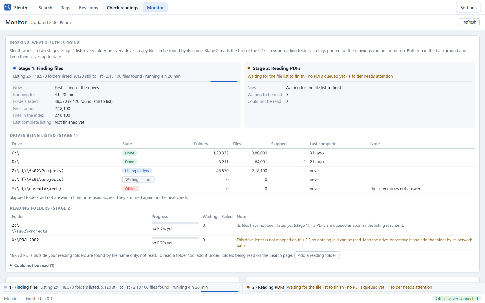<br><sub><b>Stage 1, finding files:</b> every drive with its progress, and why a drive or reading folder needs attention.</sub></td>
    <td width="50%">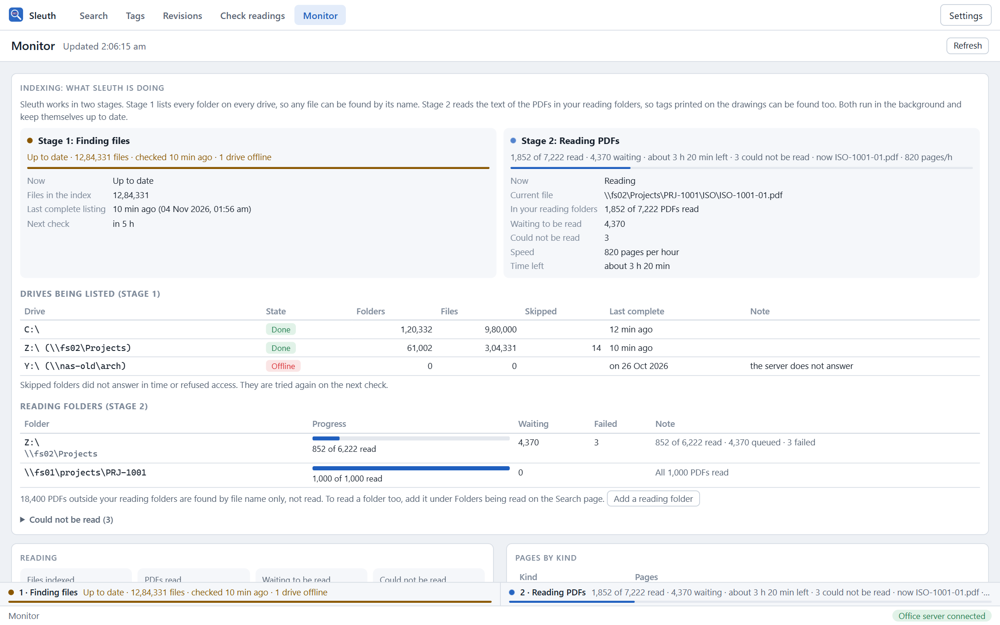<br><sub><b>Stage 2, reading PDFs:</b> read of total per reading folder, speed and time left.</sub></td>
  </tr>
</table>

| | |
|---|---|
| **The whole drive is listed** | The first listing of the office drives finds over 1.5 million files, where 1.0.0 stopped at 150,000. A listing stopped half-way resumes where it was; a short network drop is retried instead of skipping a drive for hours. |
| **Reading folders first** | Folders you chose for reading are listed first, and their PDFs are read as soon as their drives are listed. A busy PC reads slowly instead of not at all. |
| **File names like Everything** | Any length (`FS`, `_`, `&`), `*` and `?`, several words across name and folder, a pasted full path, exact names first, upper and lower case in any alphabet. |
| **Robust index** | Never thrown away because it was busy; its temporary log stays small; one share reached by name and by IP address is listed once. |

## New in 1.0

| | |
|---|---|
| **Reads only what needs reading** | Every page is classified: plotted text, scan, *hybrid* (a plotted drawing with a pasted scan or site mark-up), outlined text, damaged. Plotted drawings need no OCR; on hybrids only the images are read. 0.1 skipped mark-ups smaller than 40% of the sheet; 1.0 reads them. |
| **Explains every match** | Exact · Separators ignored · Verify (look-alikes, low confidence) · Partial (inside a longer tag, or only part read). Never a fuzzy match shown as exact. |
| **Engineering data** | Line numbers, instruments, valves, equipment, supports, welds, drawing numbers and specs, plus title-block details (drawing number, revision, title, sheet, discipline, status), each with the line it was read from. Rules are configurable. |
| **Tags · Revisions · Related** | Browse every tag and where it appears. Compare two revisions of a drawing side by side. See other drawings sharing tags. |
| **Check readings** | Low-confidence OCR lines with the image beside them; type what is printed. The original reading is kept and nothing is learned from it. |
| **Graphics card, only when proven** | OCR may run through DirectML, but only after the card read a check picture exactly like the CPU and was clearly faster. |
| **Projects, OR, filters, export** | `PSV-1203 OR PSV-1204`, `rev:C dwg:ISO-1001`, `type:instrument FV`, `name:datasheet`; history and pinned searches; CSV and Excel export. |
| **Optional office server** | The same engine over shared project folders, HTTPS, access keys and per-project permissions. Each PC keeps working on its own when it is offline. |

No AI of any kind: no language models, chat, generated summaries or learning from users. OCR uses fixed, pinned PP-OCRv6 models whose hash is recorded with every reading.

## Screenshots

<table>
  <tr>
    <td width="50%">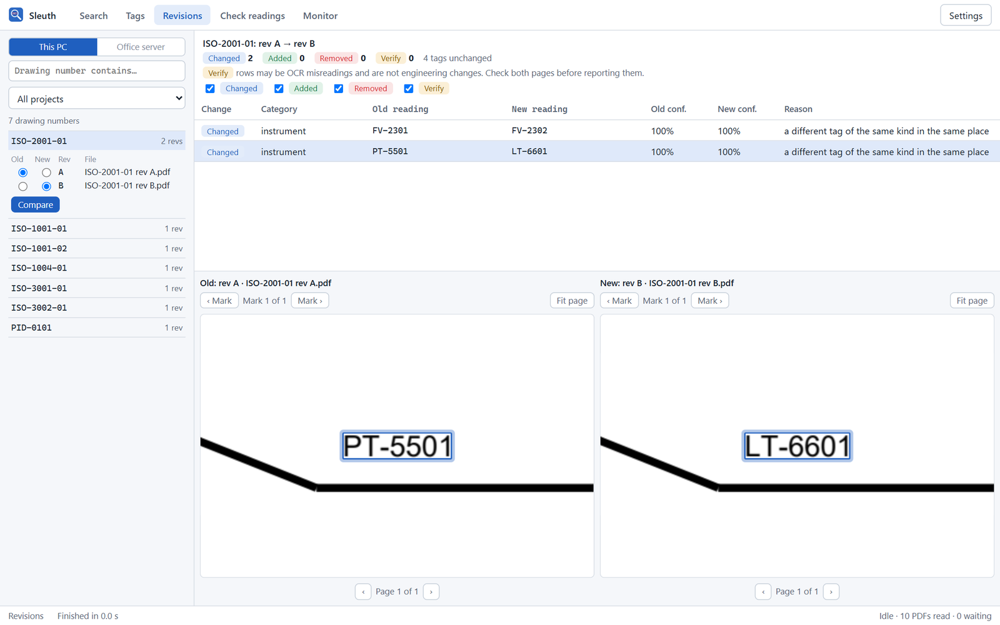<br><sub><b>Revisions:</b> rev A against rev B, every changed tag marked on both sheets.</sub></td>
    <td width="50%">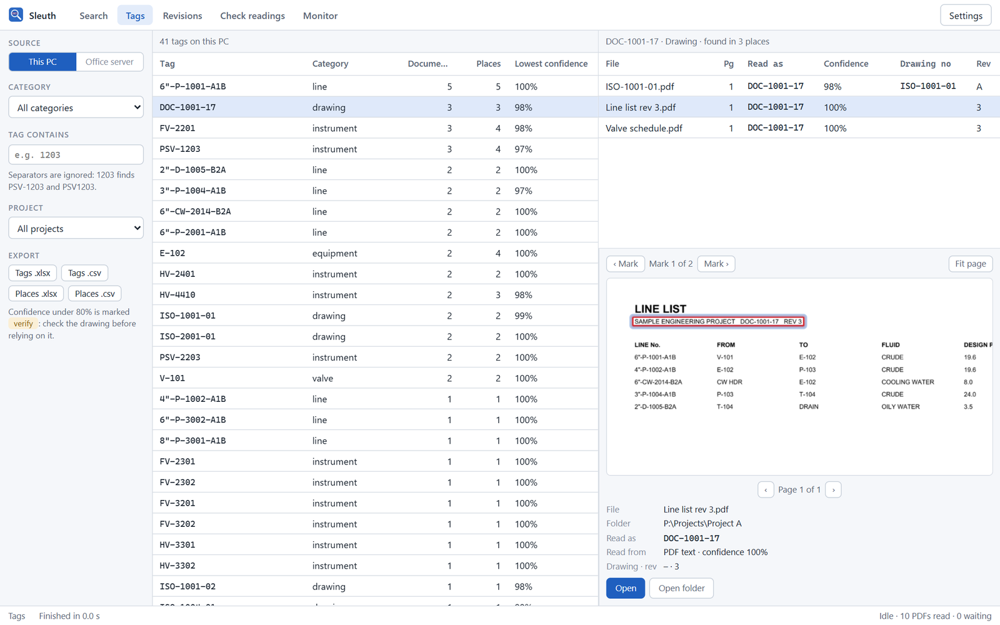<br><sub><b>Tags:</b> every tag, where it appears, and how surely it was read.</sub></td>
  </tr>
  <tr>
    <td>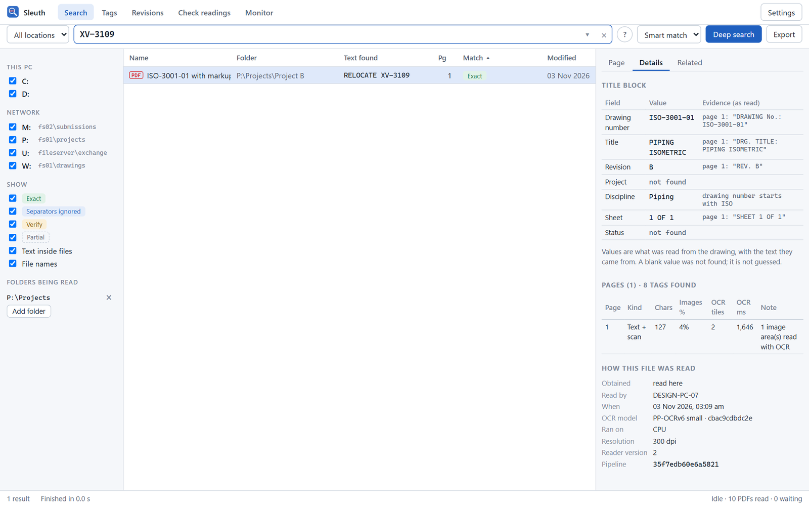<br><sub><b>Evidence:</b> title-block values with the line they came from, and how the file was read.</sub></td>
    <td>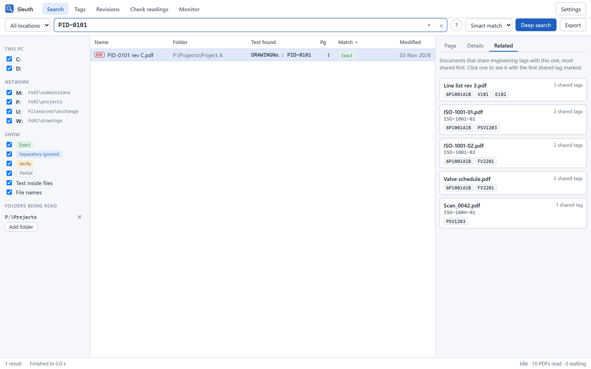<br><sub><b>Related:</b> drawings sharing tags with the one open.</sub></td>
  </tr>
  <tr>
    <td>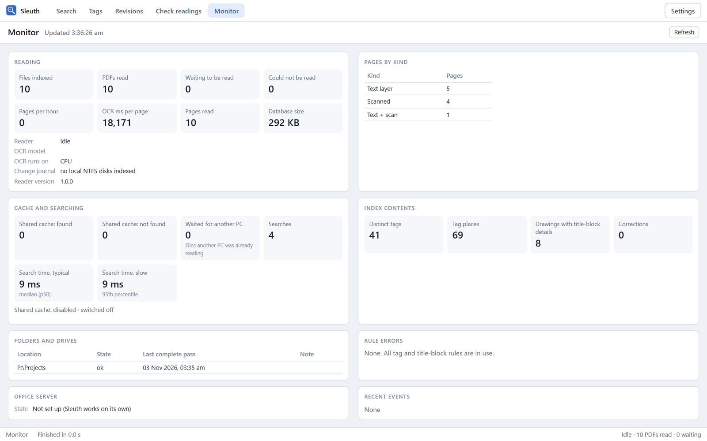<br><sub><b>Monitor:</b> reading, cache, search times, and why OCR runs where it does.</sub></td>
    <td>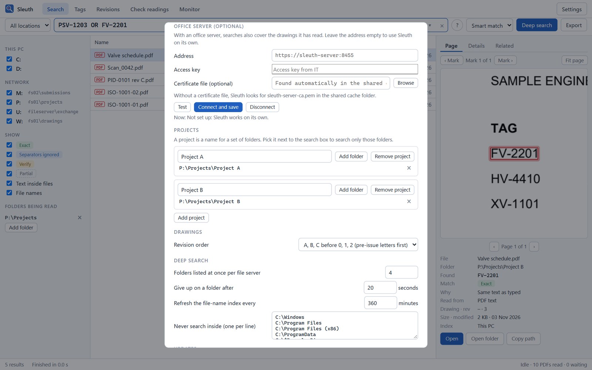<br><sub><b>Projects and office server:</b> both optional.</sub></td>
  </tr>
</table>

<sub>Screenshots show Sleuth 1.0 running against the real reader with sample drawings. Folder, drive and PC names are examples.</sub>

## Get started

1. **Download** `Sleuth_x.y.z_x64-setup.exe` from the [latest release](https://github.com/dexterity-admin/Sleuth/releases/latest) and run it. It installs for your account only, with no admin rights needed.

   Windows may say it protected your PC, because the installer isn't code-signed. Click **More info**, then **Run anyway**. Later updates install from inside Sleuth without that prompt.

   **Updates come to you.** Sleuth checks every hour, downloads a new version in the background, and asks: **Restart and update** or **Later**. Later leaves an **Update ready** button in the status bar.
2. **Shared cache:** Sleuth connects to `U:\Sleuth-cache` by itself. If it can't, it shows you where to fix it.
3. **Add your project folders** under *Folders being read*, and name them as projects in Settings if you like.
4. **Search.** Type a tag. Use **Deep search** when you don't know where a file is.

Updating from 0.1 keeps your settings and index. Drawings already read stay searchable; their tags and title blocks are parsed from the stored text without OCR. Settings → Updates can roll back to the previous release.

The [user guide](docs/Sleuth-User-Guide.pdf) covers everything, from installation to troubleshooting. The optional office server has its own guide: [docs/SERVER.md](docs/SERVER.md).

## How it works

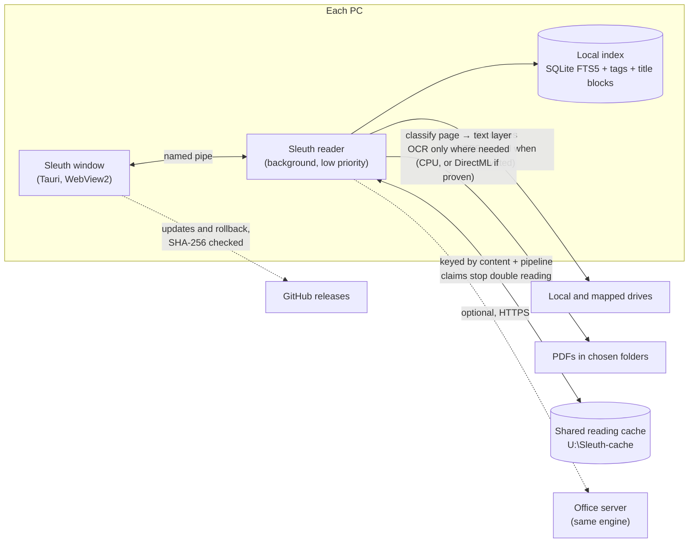

Design notes are in [docs/ARCHITECTURE.md](docs/ARCHITECTURE.md). Reader measurements on a reproducible synthetic corpus, and how to measure on your own drawings, are in [bench/](bench/README.md).

## For developers

You need Windows 10/11, Rust (stable, MSVC), Node 20+ and the Visual Studio C++ build tools. No keys, secrets or tokens are needed anywhere.

```powershell
./scripts/build.ps1                    # tests, worker, server, installer and server zip
cargo test --release --workspace --exclude sleuth
cargo run --release -p sleuth-engine --example probe -- "drawing.pdf"   # read one PDF: page classes and lines
cargo run --release -p sleuth-engine --example bench -- .devdata/corpus  # reader benchmark
```

Set `SLEUTH_DATA_DIR` to keep a test run's settings, index and logs in one folder instead of AppData. IT can install silently with `Sleuth_x.y.z_x64-setup.exe /S`, or `/S /D=C:\Tools\Sleuth` to choose the folder (`/D=` must come last).

| Path | What it is |
|---|---|
| `crates/sleuth-core` | Tag matcher and query language, drive-letter/UNC map, settings, IPC protocol |
| `crates/sleuth-engine` | Page classification, OCR and backends, SQLite/FTS5 index, tag and title-block rules, workflows, drive walker and change journal, shared cache, office client |
| `apps/worker` | `sleuth-worker.exe`: background reader and index, named-pipe server |
| `apps/server` | `sleuth-server.exe`: optional office server (HTTPS API, permissions, audit, Windows service) |
| `apps/desktop` | `Sleuth.exe`: Tauri 2 window (`ui/`), updater and rollback, export |
| `bench` | Synthetic benchmark corpus and results |
| `site` | The website at [dexterity-admin.github.io/Sleuth](https://dexterity-admin.github.io/Sleuth/) |
| `docs` | User guide, architecture, server guide, README images |

### Releases

Everything runs on GitHub Actions with its built-in token.

- **Every push or pull request** builds and tests, and uploads the installer and server zip as workflow artifacts.
- **A push to `main`** replaces the `dev` pre-release, for the Development update channel.
- **A tag `vX.Y.Z`** that matches the version in `Cargo.toml` publishes a stable release (installer, server zip, `latest.json` naming the previous release for rollback), which installed copies update to.
- **Changes under `site/` or the user guide** redeploy the website.

To release:

1. Bump `version` in `Cargo.toml`.
2. Add a `## X.Y.Z` section to `CHANGELOG.md`.
3. Commit, then tag `vX.Y.Z` and push the tag.

---

<sub>Sleuth · internal tool of Dexterity Design Services Pvt. Ltd. · Built with Rust, Tauri, PDFium, SQLite and PP-OCRv6.</sub>
