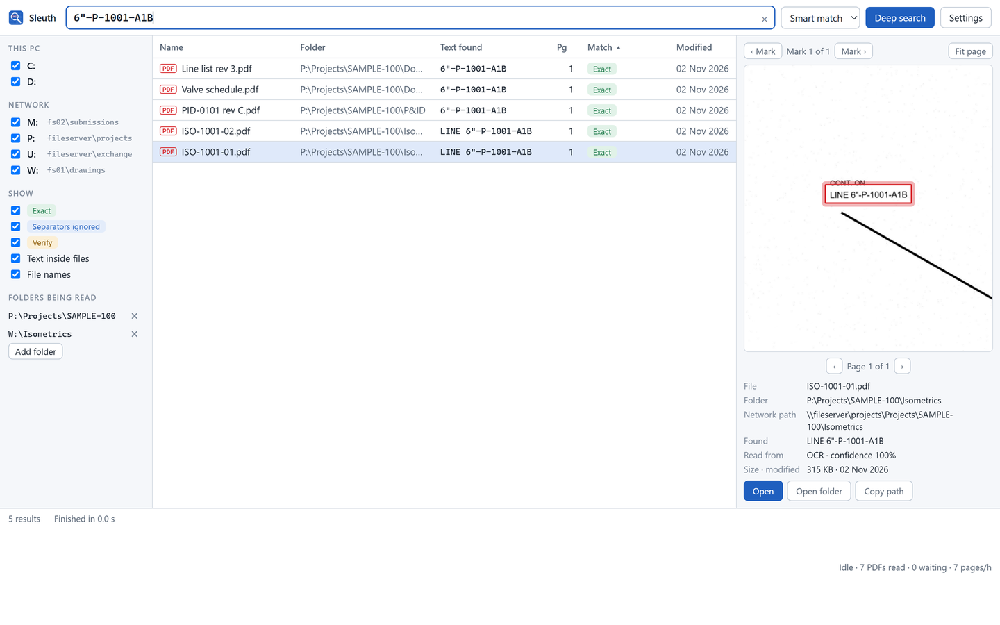
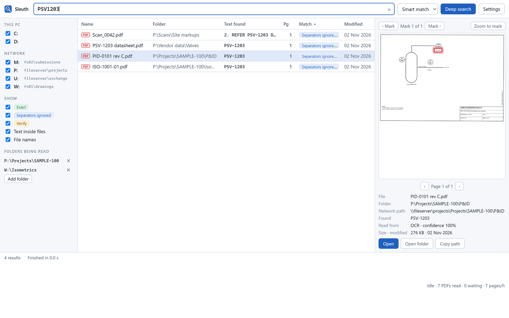
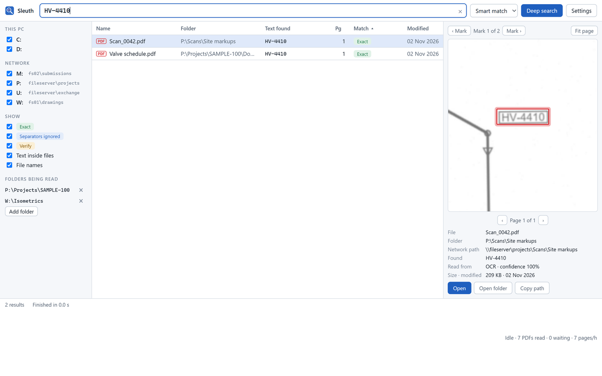
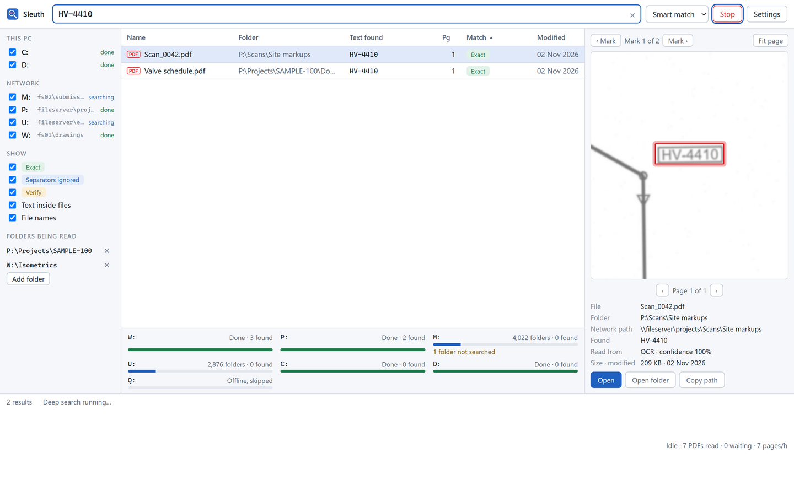
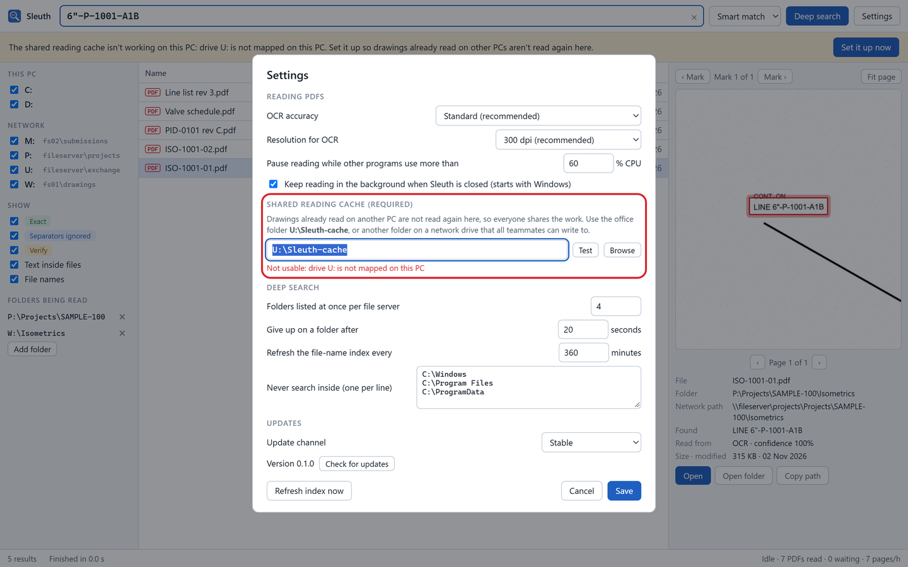
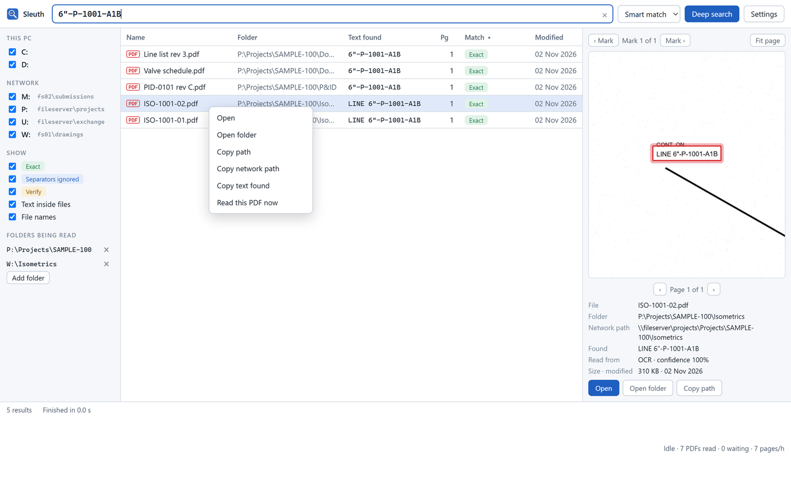
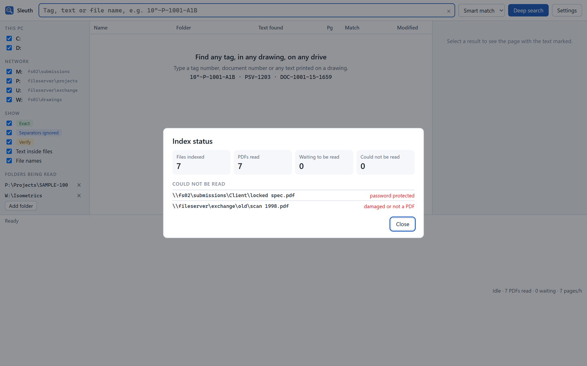
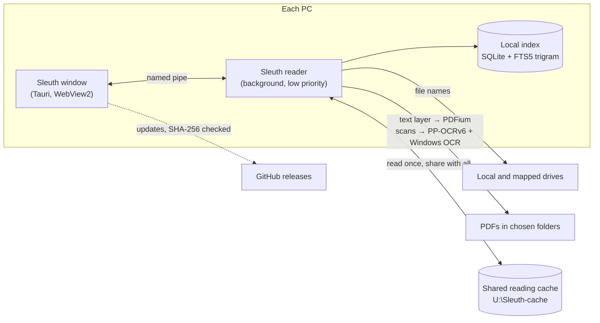

<p align="center">
  <a href="https://dexterity-admin.github.io/Sleuth/"></a>
</p>

<p align="center">
  <a href="https://github.com/dexterity-admin/Sleuth/releases/latest"></a>
  <a href="https://github.com/dexterity-admin/Sleuth/actions/workflows/build.yml"></a>
  
  <a href="docs/Sleuth-User-Guide.pdf"></a>
</p>

<h3 align="center">
  <a href="https://github.com/dexterity-admin/Sleuth/releases/latest">Download</a> ·
  <a href="https://dexterity-admin.github.io/Sleuth/">Website</a> ·
  <a href="docs/Sleuth-User-Guide.pdf">User guide (view)</a> ·
  <a href="https://github.com/dexterity-admin/Sleuth/raw/main/docs/Sleuth-User-Guide.pdf">User guide (download)</a>
</h3>

**Sleuth** is the internal drawing search tool of Dexterity Design Services. Type a tag, line number, document number or any text printed on a drawing. Sleuth shows every file that contains it and opens the page with the text **circled in red**, even when the PDF is a scan.

<p align="center"></p>

## Why Sleuth

File-name search, and tools like Everything, can't see inside a scanned isometric. Sleuth reads every page once and remembers it, so every search afterwards takes milliseconds.

| | |
|---|---|
| **Reads scans** | Uses the PDF's text layer where there is one. Pages without one go through PP-OCRv6 at 300 dpi in overlapping tiles, so 2.5 mm text, rotated and vertical text are read at full resolution. Lines the OCR is unsure of get a second reading from Windows' built-in OCR. |
| **Understands tags** | `6"-P-1001-A1B`, `6-P-1001-A1B`, `6P1001A1B` and `FV 2201` all find their tag. Look-alike OCR confusions (O/0, l/1, S/5, B/8) are found and labelled **Verify**, never counted as exact. |
| **Every drive, nothing hangs** | Deep search walks local and mapped network drives with a few listings at a time per file server. Offline shares are skipped in seconds, and slow folders are listed, never silently dropped. |
| **Shows the evidence** | Each result shows which page, how it was read and how sure the reader was. The preview marks the spot. |
| **Office-wide** | A shared reading cache (`U:\Sleuth-cache`) means each drawing is read once for the whole office. Sleuth won't stop asking until every PC has it set up. |
| **Light and polite** | Reading runs in the background at low priority. It pauses while you're busy or on battery, and frees its memory when idle. |
| **Updates itself** | New versions install from inside the app after a SHA-256 check. Settings and index are never touched. |

## Screenshots

<table>
  <tr>
    <td width="50%"><br><sub><b>Separators ignored:</b> <code>PSV1203</code> finds <code>PSV-1203</code> on the P&amp;ID.</sub></td>
    <td width="50%"><br><sub><b>Faint scans:</b> <code>HV-4410</code> read off a low-contrast site scan.</sub></td>
  </tr>
  <tr>
    <td><br><sub><b>Deep search:</b> live progress per drive, with offline shares skipped.</sub></td>
    <td><br><sub><b>Shared cache, enforced:</b> Sleuth highlights exactly what to fix.</sub></td>
  </tr>
  <tr>
    <td><br><sub><b>One-click actions:</b> open, open folder, or copy the path or network path.</sub></td>
    <td><br><sub><b>Nothing hidden:</b> what's read, what's waiting, and what couldn't be read, with the reason.</sub></td>
  </tr>
</table>

<sub>Screenshots show Sleuth's own interface with results read from sample drawings. Folder and server names are examples.</sub>

## Get started

1. **Download** `Sleuth_x.y.z_x64-setup.exe` from the [latest release](https://github.com/dexterity-admin/Sleuth/releases/latest) and run it. It installs for your account only, with no admin rights needed.

   Windows may say it protected your PC, because the installer isn't code-signed. Click **More info**, then **Run anyway**. Later updates install from inside Sleuth without that prompt.
2. **Shared cache:** Sleuth connects to `U:\Sleuth-cache` by itself. If it can't, it shows you where to fix it.
3. **Add your project folders** under *Folders being read*. Sleuth reads their PDFs in the background.
4. **Search.** Type a tag. Use **Deep search** when you don't know where a file is.

The [user guide](docs/Sleuth-User-Guide.pdf) (21 pages, with screenshots) covers everything, from installation to troubleshooting, and ends with a one-page quick reference card for your desk.

## How it works



Design notes, and what we learned from Everything's internals, are in [docs/ARCHITECTURE.md](docs/ARCHITECTURE.md).

## For developers

You need Windows 10/11, Rust (stable, MSVC), Node 20+ and the Visual Studio C++ build tools. No keys, secrets or tokens are needed anywhere.

```powershell
./scripts/build.ps1                    # tests, worker and installer -> target\release\bundle\nsis
cargo test -p sleuth-core -p sleuth-engine
cargo run --release -p sleuth-engine --example probe -- "drawing.pdf"   # read one PDF and print its lines
```

Set `SLEUTH_DATA_DIR` to keep a test run's settings, index and logs in one folder instead of AppData. IT can install silently with `Sleuth_x.y.z_x64-setup.exe /S`, or `/S /D=C:\Tools\Sleuth` to choose the folder (`/D=` must come last).

| Path | What it is |
|---|---|
| `crates/sleuth-core` | Tag matcher, drive-letter/UNC map, settings, IPC protocol |
| `crates/sleuth-engine` | PDF text layer, OCR, SQLite/FTS5 index, drive walker, search, shared cache |
| `apps/worker` | `sleuth-worker.exe`: background reader and index, named-pipe server |
| `apps/desktop` | `Sleuth.exe`: Tauri 2 window (`ui/`) and the in-app updater |
| `site` | The website at [dexterity-admin.github.io/Sleuth](https://dexterity-admin.github.io/Sleuth/) |
| `docs` | User guide (PDF and HTML source), architecture notes, README images |

### Releases

Everything runs on GitHub Actions with its built-in token.

- **Every push or pull request** builds and tests, and uploads the installer as a workflow artifact.
- **A push to `main`** replaces the `dev` pre-release, for the Development update channel.
- **A tag `vX.Y.Z`** that matches the version in `Cargo.toml` publishes a stable release, which installed copies update to.
- **Changes under `site/` or the user guide** redeploy the website.

To release:

1. Bump `version` in `Cargo.toml`.
2. Add a `## X.Y.Z` section to `CHANGELOG.md`.
3. Commit, then tag `vX.Y.Z` and push the tag.

---

<sub>Sleuth · internal tool of Dexterity Design Services Pvt. Ltd. · Built with Rust, Tauri, PDFium and PP-OCRv6.</sub>
